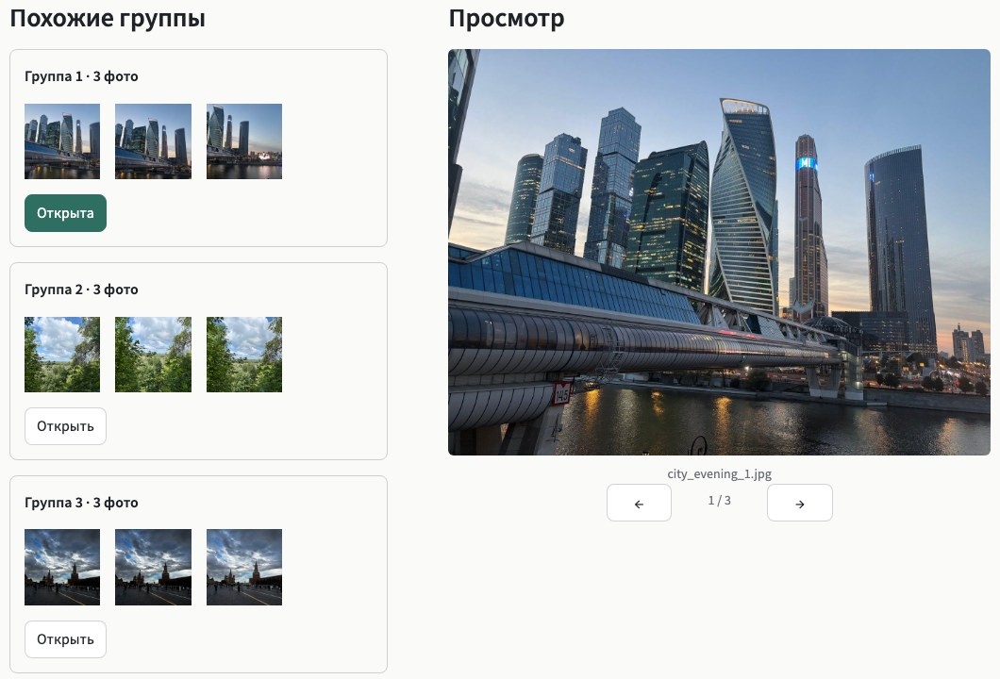

**English** | [Русский](README.ru.md)

# Similar shots, side by side

Photo series often contain several almost identical shots. This demo groups them for quick
comparison, so you can decide what to keep. Try it with your own photos or four sample series.

**Live demo:** https://ai-photo-dedup-demo.streamlit.app/

No photos handy? Click **Explore sample photos**. Free Streamlit hosting may put the app to sleep
after inactivity. If you see **Yes, get this app back up!**, click it; startup usually takes about
a minute.



## How it works

1. ResNet50 with its classification head removed turns each photo into a 2,048-dimensional
   embedding.
2. The embeddings are normalized, then DBSCAN groups them by cosine distance.
3. Photos in the same cluster appear together. The **Sensitivity** slider controls DBSCAN's `eps`:
   lower values mean stricter grouping.

Uploaded photos remain in the current session. The app writes temporary copies for analysis and
deletes them when the run finishes.

## Limits

- The model finds similar shots; it never picks the best one or deletes anything.
- You can upload JPG and PNG files. Convert iPhone HEIC photos before uploading.
- Because ResNet50 was trained on ImageNet, it may group different shots of the same scene. Adjust
  the sensitivity when needed.

## Run locally

```bash
pip install -r requirements.txt
streamlit run app.py
```

`requirements.txt` targets Streamlit Cloud on Linux and pins CPU builds of PyTorch. On macOS,
install the same `torch` and `torchvision` versions without the `+cpu` suffix.

## Stack

Python, Streamlit, PyTorch / torchvision (ResNet50), scikit-learn (DBSCAN), Pillow.

## Sample photos

The 12 photos in `sample_photos/` are from Katherine Mironova's own collection. The public demo
uses resized copies with EXIF, including location data, removed. See
[`sample_photos/CREDITS.md`](sample_photos/CREDITS.md).
